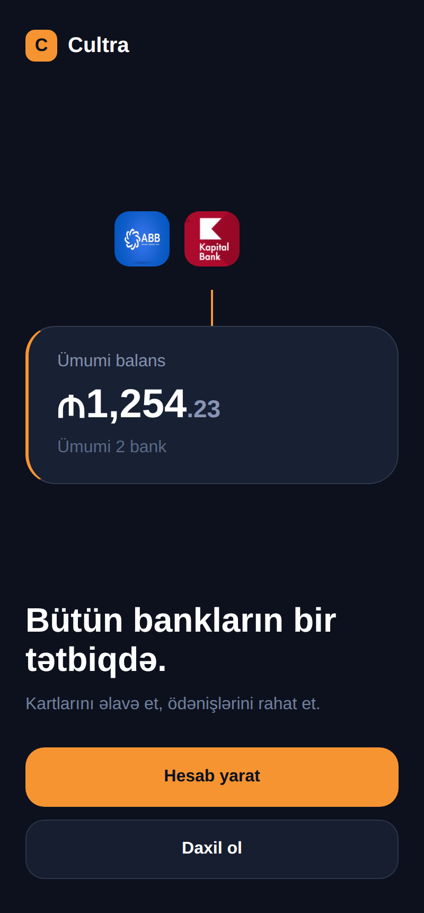
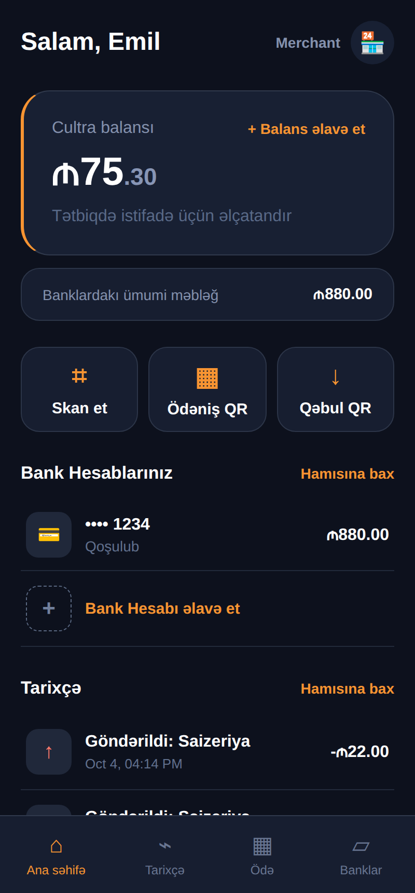
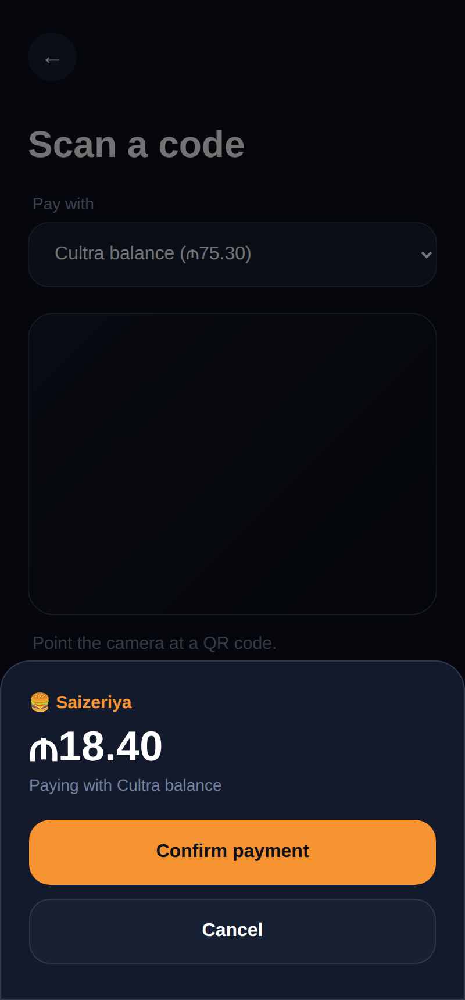
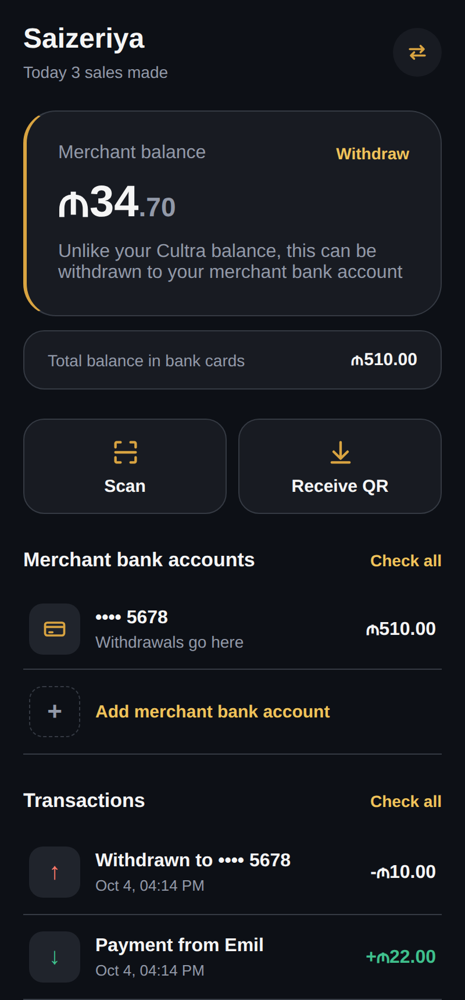
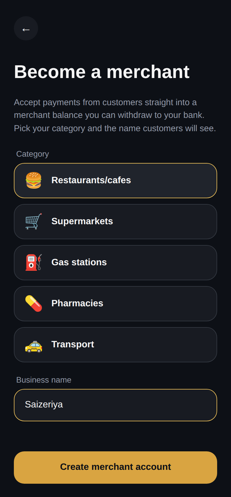
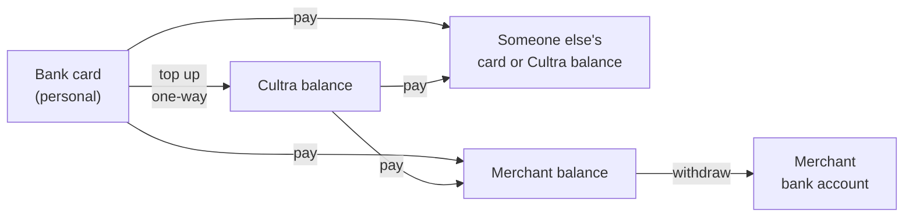
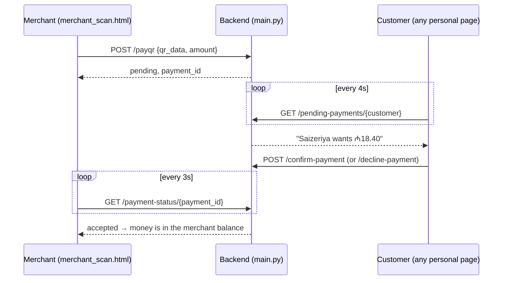

# Cultra

**Reminder: This project is still demo and u can view the app with the apk file above -> **

**All your banks in one app.** Cultra is a QR-based payment app: link your bank cards, keep an in-app balance, and pay or get paid by scanning a code. Businesses can switch to a separate **merchant** mode with their own balance, bank accounts and sales history.

> Status: working prototype, also as an Android app. The whole app is in Azerbaijani. The backend saves everything in a database (a file on your laptop, PostgreSQL online), and the bank cards are simulated. See [Roadmap](#roadmap) for what's next.

<p>
  
  
  
  
  
</p>

---

## Contents

- [What it does](#what-it-does)
- [How it works](#how-it-works)
  - [The three kinds of money](#the-three-kinds-of-money)
  - [The two payment flows](#the-two-payment-flows)
  - [QR code formats](#qr-code-formats)
  - [Payment barcode](#payment-barcode)
  - [Cashback](#cashback)
  - [Levels (XP)](#levels-xp)
  - [Rules the server enforces](#rules-the-server-enforces)
- [Running it locally](#running-it-locally)
- [Phone app and online server](#phone-app-and-online-server)
- [Project structure](#project-structure)
- [API reference](#api-reference)
- [What's been built so far](#whats-been-built-so-far)
- [Known limitations](#known-limitations)
- [Roadmap](#roadmap)

---

## What it does

**As a customer (personal mode)**
- Create an account and log in.
- Link bank cards and see their balances, plus a total across all cards.
- Top up your **Cultra balance** from a card. Top-ups are one-way.
- **Scan** someone's receive QR and pay instantly from a card or your Cultra balance.
- **Send money by username.** Tap the 🔍 button at the top right of the home page, search for someone, pick them, and send from a card or your Cultra balance. It lands in their Cultra balance.
- **Send to any bank card** by typing its 16-digit number and an amount (the **Göndər** tile on the home page).
- Show your own **Receive QR** with any amount or a fixed amount, paid into a card or your Cultra balance. The page says the moment the money arrives.
- Show your **Payment QR** so a merchant can charge you. Nothing is taken until you approve the popup. The page also shows a **barcode** for shop scanners that only read barcodes.
- Get **cashback** into your Cultra balance whenever you pay a merchant, shown under the amount in your history. The home page shows this month's total, and the **Keşbek** page shows each category against its monthly cap (e.g. Restoran və kafelər ₼4.50 / ₼10.00).
- Earn **XP** for paying merchants and climb **levels** (Bürünc → Gümüş → Qızıl → Platin) that raise your cashback caps. Levels follow recent use, so they drop again if you stop. See [Levels (XP)](#levels-xp).
- See your transaction history, with the cashback, XP and products of each purchase. After any payment or top-up you're taken back to the main menu with a short confirmation.

**As a merchant (merchant mode, called "Biznes" in the app)**
- Register once with a **category** and a **business name**. Customers see the business name instead of your username.
- Generate a fixed-amount **Receive QR** that customers scan and pay. Each payment shows up on the page as it arrives.
- **Checkout:** scan product barcodes into a cart (quantities, running total), then scan the customer's Payment QR or barcode to charge the total. The customer approves it on their phone. With an empty cart, type any amount instead.
- Collect money in a **merchant balance**, separate from your personal Cultra balance.
- **Withdraw** the merchant balance to your merchant bank accounts.
- See today's sales count, the total in your merchant bank accounts, and the full transaction history, including what each checkout sale contained.

Merchant pages use their own dark/gold theme so it's always obvious which mode you're in.

---

## How it works

The app is two parts:

| Part | Tech | Role |
|---|---|---|
| Backend | Python, [FastAPI](https://fastapi.tiangolo.com/) (`main.py`) | Owns all balances and rules. Every payment is validated here. `storage.py` saves the data: into `cultra.db` (SQLite) on your laptop, into PostgreSQL (Supabase) online. |
| Frontend | Plain HTML, CSS and JavaScript pages | Calls the backend with `fetch()`. Uses [qrcodejs](https://github.com/davidshimjs/qrcodejs) to draw QR codes, [html5-qrcode](https://github.com/mebjas/html5-qrcode) 2.3.8 to scan them and [JsBarcode](https://github.com/lindell/JsBarcode) for barcodes, all kept in `vendor/`. |
| Phone app | [Capacitor](https://capacitorjs.com/) 8 | The same pages as an Android app, with the phone's own scanner ([ML Kit](https://github.com/capawesome-team/capacitor-mlkit)). See [Phone app and online server](#phone-app-and-online-server). |

The logged-in user's id is sent with each request. It's kept per tab (`sessionStorage`, so two tabs can be two people while testing) and remembered (`localStorage`, so the phone app stays logged in).

Every page loads `config.js`, which says where the backend is. In a browser it's the computer that serves the pages (port 8000): opened on the laptop that's `http://127.0.0.1:8000`; opened from a phone on the same Wi-Fi it becomes `http://<laptop-ip>:8000` automatically. The phone app always uses the online server (`SERVER_URL`), and a browser can too with `?server=online` at the end of the address. The scanner library has no language setting, so `scanner_az.js` replaces its English buttons and messages with Azerbaijani.

The server saves after every request that changed something, and loads everything back when it starts. The very first start (empty database) saves the demo data from `main.py`; after that the database wins.

### The three kinds of money



| Account | Id in code | Spend from it? | Receive into it? |
|---|---|---|---|
| Bank card | the 16-digit card number | yes | yes |
| Cultra balance | `APP_BALANCE` | yes | yes |
| Merchant balance | `MERCHANT_BALANCE` | **no**, only withdraw to a merchant bank account | yes, merchants only |

Two things keep this consistent:

- **Bank balances live in one place.** That place is the `bankcards` dict, which stands in for the bank. A user's linked cards only point at it, so a card linked to both a personal and a merchant account (or to two users) is still one balance, not a copy.
- **Two separate account checks.** `can_pay_from()` decides what you may spend from and `can_receive_into()` decides what you may receive into. The merchant balance is only in the second.

### The two payment flows

**1. Push: the payer scans.** The receiver shows a `PAY:` code. The payer scans it, picks which account to pay from, and confirms. Money moves immediately.

**2. Pull: the merchant scans.** The customer shows their `PAY_QR:` code. The merchant scans it and types an amount, which creates a *pending* payment. The customer gets a popup on whatever page they're on, and the money only moves when they approve.



### QR code formats

QR codes are plain text, with fields separated by `:`.

| Code | Format | Shown by | Scanned by |
|---|---|---|---|
| Receive | `PAY:<receiver_id>:<account>:<amount or any>:<AZN or USD>` | anyone (Receive QR) | customers (`scan.html`) |
| Merchant receive | `PAY:<merchant_id>:MERCHANT_BALANCE:<amount>:<AZN or USD>` | merchants, fixed amount only | customers (`scan.html`) |
| Payment | `PAY_QR:<payer_id>:<account>` | customers (Payment QR) | merchants (`merchant_scan.html`) |

With `any`, the payer types the amount before paying. USD amounts are converted to AZN at a fixed rate of 1.7.

### Payment barcode

The Payment QR page also shows a barcode above the QR code, for local shops whose scanners read barcodes. A barcode is one row of bars, so it can't hold the long `PAY_QR:` text and still be scannable from a phone. Instead it holds a **16-digit number**, and the backend remembers what that number stands for:

```
62 1982233674628 5
│        │       └─ check digit (same method as bank card numbers): catches a misread digit
│        └───────── 13 random digits: can't be guessed
└────────────────── 62 = payment code
```

1. The page asks `POST /barcode` for a code for the chosen account. The server builds `PAY_QR:<user>:<account>` itself and saves it under a new random number.
2. The page draws the number as a Code 128 barcode, with the digits underneath so a cashier can type them if the scan fails.
3. The merchant's scanner reads the barcode, or the cashier types the digits, and sends the number to `/payqr`. The server looks up the text and continues exactly as for a QR code. Approval and cashback work the same way.

Each code:

- **stays the same while the page is open.** There's no timer: a new one is made only when the Payment QR page is opened again (or the account is switched), the same way the QR code never changes on its own.
- **replaces the user's previous code** the moment a new one is made, so an old screenshot stops working.
- **can be scanned more than once** while it's on screen. That's as safe as the QR code: every request still has to be approved in the customer's popup.

### Cashback

A payment counts as a purchase from a merchant when the money lands in a `MERCHANT_BALANCE`. The server only allows that for registered merchants, so it can't be faked by editing a QR code. Every such payment earns the customer cashback, whichever way it was paid:

- **Push:** the customer scans the merchant's Receive QR (`/pay`).
- **Pull:** the merchant scans the customer's Payment QR and the customer approves (`/payqr` then `/confirm-payment`).

The rate and the monthly cap come from the merchant's category:

| Category | Cashback | Monthly cap |
|---|---|---|
| 🍔 Restoran və kafelər | 1.8% | ₼10 |
| 🛒 Supermarketlər | 0.5% | ₼5 |
| ⛽ Yanacaq məntəqələri | 0.5% | ₼5 |
| 💊 Apteklər | 1% | ₼5 |
| 🚕 Nəqliyyat | 1% | ₼3 |

These are the base caps. A higher [level](#levels-xp) multiplies them.

- The cap is **per customer, per category, per calendar month**. A large payment gets whatever is left of the cap, and then the cashback is ₼0 until next month. The payment itself always goes through.
- Cashback always goes into the customer's **Cultra balance**, even when they paid by bank card, because card balances mirror the bank.
- The merchant still receives the full amount. In this prototype Cultra funds the cashback.
- Paying another user (not a merchant) earns no cashback.
- Cashback is rounded to whole qəpik (2 decimals).

### Levels (XP)

Customers earn XP by paying merchants, and their level multiplies the monthly cashback caps. Levels follow **recent** use: each XP entry counts for 90 days. The full design is in [docs/levels.md](docs/levels.md).

| Earn | XP |
|---|---|
| Each merchant payment of ₼1 or more (first 5 a day) | +10 |
| First payment ever at a merchant | +25 |
| Someone you sent money to by username makes their first merchant payment | +100 |

Top-ups, receiving money and sending money between users earn nothing, so XP can't be farmed by moving money around.

| Level | Reach at (90-day XP) | Keep on the 1st if ≥ | Cashback caps |
|---|---|---|---|
| 🥉 Bürünc | 0 | | ×1 |
| 🥈 Gümüş | 300 | 210 | ×1.25 |
| 🥇 Qızıl | 1,000 | 700 | ×1.5 |
| 💎 Platin | 2,500 | 1,750 | ×2 |

- **Going up is instant**, in the payment that crosses the line. The payment message says so ("🥈 Gümüş səviyyəsi!").
- **Going down is checked on the 1st of each month**, when the caps reset anyway: below the "keep" number, the user drops **one** level. There's no timer: the first time a user is looked at in a new month, every 1st since the last check is replayed (`current_level()` in `main.py`).
- The **Keşbek** page shows the level, the XP, the way to the next level and, for the next 1st, how much XP is needed to keep the level and how much the user will have by then.

### Rules the server enforces

None of these rely on the frontend. The backend refuses the request.

- You can't pay yourself. This also blocks moving your Cultra balance into your own merchant balance and withdrawing it, which would get around the one-way top-up rule.
- Amounts must be positive real numbers. `0`, negatives, `nan` and `inf` are rejected.
- You can't spend more than the account holds.
- You can't send to a card linked to your own account (personal or merchant). Sending from the Cultra balance to your own card would undo the one-way top-up.
- Money sent by username always lands in the recipient's Cultra balance. The app only sends a username, never an account, and user search returns usernames only, never user ids.
- Only registered merchants can create payment requests with `/payqr`. This is checked from the user's profile on the server, never from a flag the app sends.
- The merchant balance can't be used to pay, only withdrawn, and only to the merchant's own merchant bank accounts.
- A user can register as a merchant once. Business names must be 2–40 characters and unique, and the category must be one of the five supported.
- A card can't be linked twice to the same list.
- Usernames are 3–20 characters, and unique ignoring upper/lower case ("emil" is taken if "Emil" exists), so nobody can pose as someone else when receiving money by username.
- XP only comes from merchant payments of ₼1 or more, at most 5 payment XP a day.

---

## Running it locally

**Requirements:** Python 3.10+ and a browser.

```bash
# 1. Install the backend dependencies
pip install -r requirements.txt

# 2. Start the API (http://127.0.0.1:8000)
uvicorn main:app --reload

# 3. In a second terminal, serve the pages
python -m http.server 5500
```

Then open **http://localhost:5500/**, the welcome page (`index.html`). You can also open the pages with VS Code's Live Server. Serving from `localhost` rather than opening the files directly is the safest way to make sure the browser lets the scanner use the camera.

**Demo with a phone.** Start the backend with `uvicorn main:app --reload --host 0.0.0.0` so other devices can reach it, then open `http://<laptop-ip>:5500/` on a phone on the same Wi-Fi (`ipconfig` shows the laptop's IP). No page needs changing: `config.js` finds the backend by itself. Browsers only allow the camera on `https` or `localhost`, so let the phone show its **Payment QR** and approve the request while the laptop does the scanning.

The API's interactive docs are at **http://127.0.0.1:8000/docs**.

**Test data.** Saved in `cultra.db` next to `main.py`, so it survives restarts. Delete that file (with the server stopped) to start over from the demo data below.

| | Value |
|---|---|
| Users | `Emil` / `12345678` and `Alik` / `12345678` |
| Card 1 | `1234123412341234`, expiry `05/30`, CVV `123`, balance ₼1000 |
| Card 2 | `5678567856785678`, expiry `11/27`, CVV `456`, balance ₼500 |

To try a merchant payment, log in as Alik in one browser window and become a merchant. Log in as Emil in another, add Card 1, top up, and scan Alik's Receive QR.

---

## Phone app and online server

The Android app is the same pages wrapped with Capacitor. It talks to the backend running online on [Render](https://render.com), which saves its data in [Supabase](https://supabase.com) (PostgreSQL). Both have free plans. Step by step, from creating the database to a signed APK: **[docs/mobile-app.md](docs/mobile-app.md)**.

In short, once Node.js and Android Studio are installed:

```bash
npm install
npm run android:setup    # first time: creates the Android project in android/
npm run open             # Android Studio, then Build > Generate APKs
npm run sync             # after changing pages
```

What the app adds to the pages:

- **The phone's own scanner** (`native_scanner.js`, ML Kit through `@capacitor-mlkit/barcode-scanning`). The camera picture is drawn behind the page, which turns see-through while scanning. On Skan et it opens by itself; on the Kassa it stays open while products are scanned one after another and closes for the customer's code. ML Kit's model is inside the app, so it works on phones without Google Play too. If the camera can't start, the page falls back to the browser scanner.
- **Stays logged in**, and the welcome page goes straight to the home page.
- **Android back button:** closes an open camera or popup first, leaves the app on the home page, otherwise goes back a page.
- **"Server oyanır…"** at the top while the free server wakes up (up to a minute after 15 idle minutes).

---

## Project structure

```
Cultra/
├── main.py                       # FastAPI backend: data, rules, all endpoints
├── storage.py                    # Saves the data: cultra.db (SQLite) locally, PostgreSQL when DATABASE_URL is set
├── requirements.txt
├── render.yaml, .python-version  # The online server on Render
├── config.js                     # Where the backend is, who is logged in, the app's back button; loaded by every page
├── scanner_az.js                 # Puts the scanner library's own buttons and messages into Azerbaijani
├── native_scanner.js             # Phone app: the phone's own scanner (ML Kit), used by scan.html and merchant_scan.html
├── vendor/                       # qrcodejs, JsBarcode, html5-qrcode (+ licenses)
│
├── package.json, capacitor.config.json   # Phone app (Capacitor): versions, npm scripts, app name and id
├── scripts/build-web.js          # Copies the pages into www/ for the app
├── scripts/patch-android.js      # Camera permission, colours, icon and version in the Android project
├── resources/android/res/        # App icon
│
├── index.html                    # Welcome / landing page
├── register.html, login.html     # Sign up / log in
│
├── main_menu.html                # Personal home: level badge, search, Cultra balance, cards, cashback + send tiles, history, log out; Biznes in the bottom bar
├── send.html                     # Send money: search a username, pick an amount and an account
├── send_card.html                # Send money to a 16-digit bank card number
├── cashback.html                 # Level (XP) and how to keep it, this month's cashback per category against each cap, how levels work
├── transactions.html             # Full personal history ("Hamısına bax"), with cashback and the products bought
├── bank_cards.html               # All linked cards
├── add_bank.html                 # Link a card (personal, or merchant with ?type=merchant)
├── add_money.html                # Top up the Cultra balance from a card
├── scan.html                     # Customer scanner: pays PAY: codes
├── receive.html                  # Personal Receive QR (any or fixed amount)
├── payment_qr.html               # Personal Payment QR (PAY_QR:) + barcode, for merchants to scan
├── pending_requests.js           # Approve/decline popup, included on personal pages
│
├── merchant_register.html        # First-time setup: category + business name
├── merchant_main_page.html       # Merchant home: balance, withdraw, bank accounts, history
├── merchant_receive.html         # Fixed-amount merchant QR
├── merchant_scan.html            # Checkout: scan products into a cart, then the customer's Payment QR/barcode to charge it
├── products.html                 # Printable sheet of the demo product barcodes (from GET /products), for testing checkout
├── merchant_transactions.html    # Full merchant history ("Hamısına bax"), with the products of each checkout sale
├── merchant_bank_accounts.html   # All merchant bank accounts ("Hamısına bax")
│
├── images/                       # Bank logos for the welcome page
├── qr_test.py, scan_qr.py        # Dev helpers: generate / decode test QR images
├── qr.png, appbalance.png, receive_qr.png   # Test QR images made by qr_test.py
├── docs/levels.md                # The levels (XP) design
├── docs/mobile-app.md            # Database, online server and APK, step by step
└── docs/screenshots/             # Images used in this README
```

---

## API reference

All endpoints return JSON with `"status": "success"` or `"status": "failed"` and a `"reason"`.

**Server**

| Method | Path | Purpose |
|---|---|---|
| GET | `/` | Shows that the server is running |
| GET | `/health` | Health check (Render, and the app's "waking up" note); also says where the data is saved |

**Auth and users**

| Method | Path | Purpose |
|---|---|---|
| POST | `/register` | Create a user (username 3–20 characters, unique ignoring case; password ≥ 8 characters) |
| POST | `/login` | Returns the `user_id` |
| GET | `/users/search?q=&user_id=` | Up to 10 usernames containing `q` (2+ letters, not yourself). `ilkin` also finds `İlkin`, and `sebuhi` finds `Səbuhi` |
| GET | `/users/{user_id}` | Username and whether the user is a merchant |

**Cards and balances**

| Method | Path | Purpose |
|---|---|---|
| GET | `/bankcards/{user_id}?type=personal\|merchant` | Linked cards with live balances |
| POST | `/addbank` | Link a card; `type` is `personal` (default) or `merchant` |
| POST | `/app-balance` | Top up the Cultra balance from a personal card |
| GET | `/app-balance/{user_id}` | Cultra balance and the total across personal cards |

**Payments**

| Method | Path | Purpose |
|---|---|---|
| POST | `/pay` | Pay a `PAY:` code (push flow); returns the `cashback` and `xp` earned, and `level_up` if a new level was reached |
| POST | `/send` | Send money to a username, from the Cultra balance or a personal card, into their Cultra balance |
| POST | `/send-to-card` | Send money to any 16-digit card number (not your own linked cards) |
| GET | `/cashback/{user_id}` | This month's cashback: `total`, the level's `multiplier` and, per category, `earned`, `cap` (level included), `base_cap` and `rate` |
| GET | `/rewards/{user_id}` | Level, 90-day `xp`, `next_level`, `keep` (date of the next check, XP needed, XP the user will have by then), all `levels` and the XP `rules` |
| POST | `/barcode` | 16-digit payment barcode for one of the user's accounts (valid until the user's next barcode replaces it) |
| POST | `/payqr` | Merchant requests money from a `PAY_QR:` code or a 16-digit barcode number (pull flow). Optional `items` (barcode + qty): the server prices them and the amount must match |
| GET | `/pending-payments/{user_id}` | Requests waiting for this user's approval |
| POST | `/confirm-payment`, `/decline-payment` | Customer answers a request; confirming returns the `cashback` and `xp` earned, and `level_up` |
| POST | `/cancel-payment` | Merchant withdraws a request the customer hasn't answered yet |
| GET | `/payment-status/{payment_id}` | `pending`, `accepted` or `declined` |
| GET | `/transactions/{user_id}?limit=N` | Personal history (latest 20 by default, `limit=0` returns everything) |

**Merchant**

| Method | Path | Purpose |
|---|---|---|
| POST | `/register_merchant` | Become a merchant (category + business name) |
| GET | `/merchant/categories` | The five categories |
| GET | `/products` | Demo product list for the checkout (barcode → name, price) |
| GET | `/merchant/{user_id}` | Profile, merchant balance, `bank_total`, `sales_today` |
| GET | `/merchant/public/{user_id}` | Name and category only, shown to customers before they pay |
| GET | `/merchant/transactions/{user_id}?limit=N` | Merchant history (`limit=0` returns everything) |
| POST | `/merchant/withdraw` | Merchant balance → merchant bank account |

---

## What's been built so far

1. **Core app.** Registration, login, linking cards against the simulated bank, and the personal home page.
2. **QR payments.** The push flow (`PAY:`), any or fixed amount, AZN and USD.
3. **Payment requests.** The pull flow (`PAY_QR:`) with an approval popup that appears on any personal page.
4. **Cultra balance.** One-way top-ups from cards. It can be used to pay and to receive, everywhere a card can.
5. **Merchant mode.** Registration, business name and category, merchant balance, merchant bank accounts, withdrawals, separate merchant history, today's sales count, total in bank cards, and "Check all" pages.
6. **Hardening.**
   - Bank balances moved to a single source of truth.
   - Server-side merchant checks replaced trust in client flags.
   - Self-payment and `nan`/`inf` amounts are blocked.
   - Re-registering no longer wipes a merchant.
   - `/users/{id}` no longer returns passwords.
   - User-typed names are escaped before being shown.
7. **Design.** A dark theme for personal pages, and a dark/gold theme for merchant pages, with a header button to switch modes.
8. **Cashback.** Category-based cashback with monthly caps on every merchant payment, paid into the Cultra balance and shown in the payment message and the transaction history.
9. **Payment barcode.** A 16-digit barcode on the Payment QR page, readable by the merchant scanner (or a 2D hand scanner) or typed in by hand. A new one is made each time the page opens.
10. **Checkout.** A supermarket-style cart on the merchant scan page: product barcodes (EAN-13) add items, and the customer's code charges the total. Prices live on the server, which checks the total; the customer sees the items when approving, and they're kept in both histories. The merchant can cancel an unanswered request. Barcodes are decoded from the full-resolution camera image, so laptop webcams can read them too.
11. **Send by username.** A 🔍 button at the top right of the home page finds people by username (forgiving about Azerbaijani letters typed on an English keyboard) and sends them money into their Cultra balance.
12. **Home page tiles.** This month's cashback (opening a page with every category's progress toward its monthly cap) and sending money to a bank card number. Merchant mode moved to the bottom bar.
13. **Levels (XP).** 90-day XP from merchant payments, four levels that multiply the cashback caps, instant rank-up and a monthly one-level drop. Shown on the home page, in every payment message and history row, and on the Keşbek page.
14. **Azerbaijani everywhere.** Every page, the merchant pages, the server's messages, the category names, dates ("13 okt, 17:47") and the scanner's own buttons.
15. **Final polish.**
    - Receive QR pages (personal and merchant) show each payment as it arrives.
    - Merchant history shows what each checkout sale contained; moving money to the bank shows a confirmation.
    - Top-ups return to the home page with a confirmation; the cards page shows expiry dates and formatted balances.
    - Usernames are validated (3–20 characters, unique ignoring case).
    - One backend address for all pages (`config.js`), which also makes phone demos work.
    - The scanner library is pinned to version 2.3.8, so a new release can't change the app overnight.
16. **Android app and online server.** The data is saved in a database (SQLite locally, PostgreSQL on Supabase online) and survives restarts; passwords are stored hashed; the backend runs on Render (`render.yaml`) with CORS limited to the app; the pages are wrapped as an Android app with Capacitor, with the phone's own scanner (ML Kit), remembered login, the back button, and the libraries bundled in `vendor/`.

---

## Known limitations

This is a prototype, and these are known gaps rather than surprises:

- **No real authentication.** The app sends a `user_id` and the server trusts it, so anyone who knows an id could act as that user.
- **One server process.** The data is held in memory and saved after each request, so the server must run as a single process (as on Render); two servers on one database would overwrite each other.
- **Simulated banks.** `bankcards` in `main.py` stands in for real banks.
- **Fixed exchange rate.** 1 USD = 1.7 AZN.
- **The phone app needs the online server.** It can't use the backend on your laptop (the app is `https`, the laptop backend plain `http`).
- **Referral XP can be farmed with fake accounts**, because signing up needs no identity check. Real sign-up (phone number / ID verification) would close it.

---

## Roadmap

**Next up**
- [x] **Cashback for customers.** See [Cashback](#cashback).
- [ ] **Real authentication.** Issue a token at login (for example a JWT) and check it on every request instead of trusting `user_id`.
- [x] **Hash passwords** (PBKDF2, from Python's standard library).
- [x] **Persistent storage** with SQLite (laptop) or PostgreSQL (online).
- [x] **Android app** with Capacitor. See [docs/mobile-app.md](docs/mobile-app.md).
- [x] **Levels (XP).** See [Levels (XP)](#levels-xp).

**Later**
- [ ] Edit the merchant profile (rename, change category).
- [ ] Live exchange rates and more currencies.
- [x] HTTPS and restricted CORS for deployment (Render).
- [ ] Store the data in proper tables (one row per user, card, transaction) once there are many users.
- [x] One UI language: Azerbaijani.
- [ ] An English version with a language switch, for investors who don't read Azerbaijani.
- [ ] Real bank integrations in place of the simulated `bankcards`.

---

Made by [Emil Aliyev](https://github.com/Aliyev-Emil).
