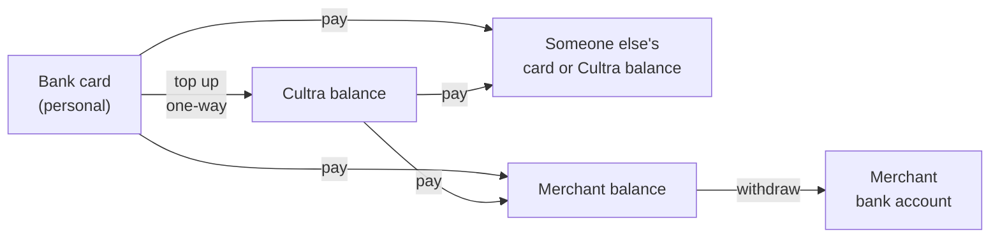
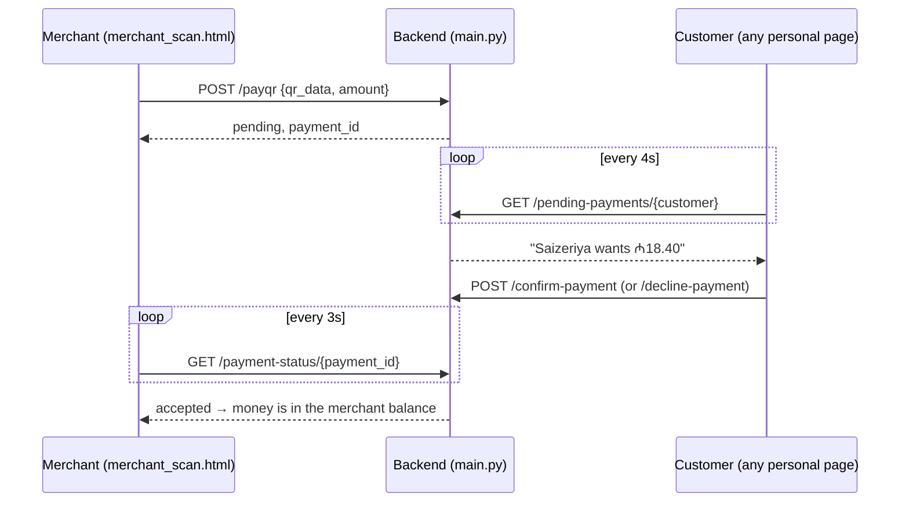

# Cultra

**All your banks in one app.** Cultra is a QR-based payment app: link your bank cards, keep an in-app balance, and pay or get paid by scanning a code. Businesses can switch to a separate **merchant** mode with their own balance, bank accounts and sales history.

> Status: working prototype. The backend keeps everything in memory, and the bank cards are simulated. See [Roadmap](#roadmap) for what's next.

<p>
  
  
  
  
  
</p>

---

## Contents

- [What it does](#what-it-does)
- [How it works](#how-it-works)
  - [The three kinds of money](#the-three-kinds-of-money)
  - [The two payment flows](#the-two-payment-flows)
  - [QR code formats](#qr-code-formats)
  - [Rules the server enforces](#rules-the-server-enforces)
- [Running it locally](#running-it-locally)
- [Project structure](#project-structure)
- [API reference](#api-reference)
- [What's been built so far](#whats-been-built-so-far)
- [Known limitations](#known-limitations)
- [Roadmap](#roadmap)

---

## What it does

**As a customer (personal mode)**
- Create an account and log in.
- Link bank cards and see their balances, plus a total across all cards.
- Top up your **Cultra balance** from a card. Top-ups are one-way.
- **Scan** someone's receive QR and pay instantly from a card or your Cultra balance.
- Show your own **Receive QR** with any amount or a fixed amount, paid into a card or your Cultra balance.
- Show your **Payment QR** so a merchant can charge you. Nothing is taken until you approve the popup.
- See your transaction history.

**As a merchant (merchant mode)**
- Register once with a **category** and a **business name**. Customers see the business name instead of your username.
- Generate a fixed-amount **Receive QR** that customers scan and pay.
- **Scan** a customer's Payment QR, enter an amount, and wait for them to approve.
- Collect money in a **merchant balance**, separate from your personal Cultra balance.
- **Withdraw** the merchant balance to your merchant bank accounts.
- See today's sales count, the total in your merchant bank accounts, and the full transaction history.

Merchant pages use their own dark/gold theme so it's always obvious which mode you're in.

---

## How it works

The app is two parts:

| Part | Tech | Role |
|---|---|---|
| Backend | Python, [FastAPI](https://fastapi.tiangolo.com/) (`main.py`) | Owns all balances and rules. Every payment is validated here. |
| Frontend | Plain HTML, CSS and JavaScript pages | Calls the backend with `fetch()`. Uses [qrcodejs](https://github.com/davidshimjs/qrcodejs) to draw QR codes and [html5-qrcode](https://github.com/mebjas/html5-qrcode) to scan them. |

The logged-in user's id is kept in `sessionStorage` and sent with each request.

### The three kinds of money



| Account | Id in code | Spend from it? | Receive into it? |
|---|---|---|---|
| Bank card | the 16-digit card number | yes | yes |
| Cultra balance | `APP_BALANCE` | yes | yes |
| Merchant balance | `MERCHANT_BALANCE` | **no**, only withdraw to a merchant bank account | yes, merchants only |

Two things keep this consistent:

- **Bank balances live in one place.** That place is the `bankcards` dict, which stands in for the bank. A user's linked cards only point at it, so a card linked to both a personal and a merchant account (or to two users) is still one balance, not a copy.
- **Two separate account checks.** `can_pay_from()` decides what you may spend from and `can_receive_into()` decides what you may receive into. The merchant balance is only in the second.

### The two payment flows

**1. Push: the payer scans.** The receiver shows a `PAY:` code. The payer scans it, picks which account to pay from, and confirms. Money moves immediately.

**2. Pull: the merchant scans.** The customer shows their `PAY_QR:` code. The merchant scans it and types an amount, which creates a *pending* payment. The customer gets a popup on whatever page they're on, and the money only moves when they approve.



### QR code formats

QR codes are plain text, with fields separated by `:`.

| Code | Format | Shown by | Scanned by |
|---|---|---|---|
| Receive | `PAY:<receiver_id>:<account>:<amount or any>:<AZN or USD>` | anyone (Receive QR) | customers (`scan.html`) |
| Merchant receive | `PAY:<merchant_id>:MERCHANT_BALANCE:<amount>:<AZN or USD>` | merchants, fixed amount only | customers (`scan.html`) |
| Payment | `PAY_QR:<payer_id>:<account>` | customers (Payment QR) | merchants (`merchant_scan.html`) |

With `any`, the payer types the amount before paying. USD amounts are converted to AZN at a fixed rate of 1.7.

### Rules the server enforces

None of these rely on the frontend. The backend refuses the request.

- You can't pay yourself. This also blocks moving your Cultra balance into your own merchant balance and withdrawing it, which would get around the one-way top-up rule.
- Amounts must be positive real numbers. `0`, negatives, `nan` and `inf` are rejected.
- You can't spend more than the account holds.
- Only registered merchants can create payment requests with `/payqr`. This is checked from the user's profile on the server, never from a flag the app sends.
- The merchant balance can't be used to pay, only withdrawn, and only to the merchant's own merchant bank accounts.
- A user can register as a merchant once. Business names must be 2–40 characters and unique, and the category must be one of the five supported.
- A card can't be linked twice to the same list.

---

## Running it locally

**Requirements:** Python 3.10+ and a browser.

```bash
# 1. Install the backend dependencies
pip install -r requirements.txt

# 2. Start the API (http://127.0.0.1:8000)
uvicorn main:app --reload

# 3. In a second terminal, serve the pages
python -m http.server 5500
```

Then open **http://localhost:5500/先.html**, the welcome page. You can also open the pages with VS Code's Live Server. Serving from `localhost` rather than opening the files directly is the safest way to make sure the browser lets the scanner use the camera.

The API's interactive docs are at **http://127.0.0.1:8000/docs**.

**Test data.** Everything resets when the server restarts.

| | Value |
|---|---|
| Users | `Emil` / `12345678` and `Alik` / `12345678` |
| Card 1 | `1234123412341234`, expiry `05/30`, CVV `123`, balance ₼1000 |
| Card 2 | `5678567856785678`, expiry `11/27`, CVV `456`, balance ₼500 |

To try a merchant payment, log in as Alik in one browser window and become a merchant. Log in as Emil in another, add Card 1, top up, and scan Alik's Receive QR.

---

## Project structure

```
Cultra/
├── main.py                       # FastAPI backend: data, rules, all endpoints
├── requirements.txt
│
├── 先.html                        # Welcome / landing page
├── register.html, login.html     # Sign up / log in
│
├── main_menu.html                # Personal home: Cultra balance, cards, history, Merchant button
├── bank_cards.html               # All linked cards
├── add_bank.html                 # Link a card (personal, or merchant with ?type=merchant)
├── add_money.html                # Top up the Cultra balance from a card
├── scan.html                     # Customer scanner: pays PAY: codes
├── receive.html                  # Personal Receive QR (any or fixed amount)
├── payment_qr.html               # Personal Payment QR (PAY_QR:), for merchants to scan
├── pending_requests.js           # Approve/decline popup, included on personal pages
│
├── merchant_register.html        # First-time setup: category + business name
├── merchant_main_page.html       # Merchant home: balance, withdraw, bank accounts, history
├── merchant_receive.html         # Fixed-amount merchant QR
├── merchant_scan.html            # Scan a customer's Payment QR and request money
├── merchant_transactions.html    # Full merchant history ("Check all")
├── merchant_bank_accounts.html   # All merchant bank accounts ("Check all")
│
├── images/                       # Bank logos for the welcome page
├── qr_test.py, scan_qr.py        # Dev helpers: generate / decode test QR images
├── qr.png, appbalance.png, receive_qr.png   # Test QR images made by qr_test.py
└── docs/screenshots/             # Images used in this README
```

---

## API reference

All endpoints return JSON with `"status": "success"` or `"status": "failed"` and a `"reason"`.

**Auth and users**

| Method | Path | Purpose |
|---|---|---|
| POST | `/register` | Create a user (password ≥ 8 characters) |
| POST | `/login` | Returns the `user_id` |
| GET | `/users/{user_id}` | Username and whether the user is a merchant |

**Cards and balances**

| Method | Path | Purpose |
|---|---|---|
| GET | `/bankcards/{user_id}?type=personal\|merchant` | Linked cards with live balances |
| POST | `/addbank` | Link a card; `type` is `personal` (default) or `merchant` |
| POST | `/app-balance` | Top up the Cultra balance from a personal card |
| GET | `/app-balance/{user_id}` | Cultra balance and the total across personal cards |

**Payments**

| Method | Path | Purpose |
|---|---|---|
| POST | `/pay` | Pay a `PAY:` code (push flow) |
| POST | `/payqr` | Merchant requests money from a `PAY_QR:` code (pull flow) |
| GET | `/pending-payments/{user_id}` | Requests waiting for this user's approval |
| POST | `/confirm-payment`, `/decline-payment` | Customer answers a request |
| GET | `/payment-status/{payment_id}` | `pending`, `accepted` or `declined` |
| GET | `/transactions/{user_id}` | Personal history (latest 20) |

**Merchant**

| Method | Path | Purpose |
|---|---|---|
| POST | `/register_merchant` | Become a merchant (category + business name) |
| GET | `/merchant/categories` | The five categories |
| GET | `/merchant/{user_id}` | Profile, merchant balance, `bank_total`, `sales_today` |
| GET | `/merchant/public/{user_id}` | Name and category only, shown to customers before they pay |
| GET | `/merchant/transactions/{user_id}?limit=N` | Merchant history (`limit=0` returns everything) |
| POST | `/merchant/withdraw` | Merchant balance → merchant bank account |

---

## What's been built so far

1. **Core app.** Registration, login, linking cards against the simulated bank, and the personal home page.
2. **QR payments.** The push flow (`PAY:`), any or fixed amount, AZN and USD.
3. **Payment requests.** The pull flow (`PAY_QR:`) with an approval popup that appears on any personal page.
4. **Cultra balance.** One-way top-ups from cards. It can be used to pay and to receive, everywhere a card can.
5. **Merchant mode.** Registration, business name and category, merchant balance, merchant bank accounts, withdrawals, separate merchant history, today's sales count, total in bank cards, and "Check all" pages.
6. **Hardening.**
   - Bank balances moved to a single source of truth.
   - Server-side merchant checks replaced trust in client flags.
   - Self-payment and `nan`/`inf` amounts are blocked.
   - Re-registering no longer wipes a merchant.
   - `/users/{id}` no longer returns passwords.
   - User-typed names are escaped before being shown.
7. **Design.** A dark theme for personal pages, and a dark/gold theme for merchant pages, with a header button to switch modes.

---

## Known limitations

This is a prototype, and these are known gaps rather than surprises:

- **No real authentication.** The app sends a `user_id` and the server trusts it, so anyone who knows an id could act as that user.
- **Plain-text passwords** in memory.
- **No database.** All users, cards and transactions are lost when the server restarts.
- **Simulated banks.** `bankcards` in `main.py` stands in for real banks.
- **Fixed exchange rate.** 1 USD = 1.7 AZN.
- **Hard-coded API address** (`http://127.0.0.1:8000`) in every page, and CORS is open to all origins.
- **Mixed languages.** Personal pages are mostly Azerbaijani, while merchant pages and some labels are English.

---

## Roadmap

**Next up**
- [ ] **Cashback for customers.** The categories in `BUSINESS_CATEGORIES` already carry a cashback % and a monthly cap. The plan is to pay cashback into the customer's Cultra balance when they pay a merchant, capped per customer, per category, per month.
- [ ] **Real authentication.** Issue a token at login (for example a JWT) and check it on every request instead of trusting `user_id`.
- [ ] **Hash passwords** (bcrypt or argon2).
- [ ] **Persistent storage** with SQLite or PostgreSQL.

**Later**
- [ ] Edit the merchant profile (rename, change category).
- [ ] A full personal history page, like the merchant "Check all".
- [ ] Live exchange rates and more currencies.
- [ ] A configurable API URL and restricted CORS for deployment.
- [ ] One UI language, or proper Azerbaijani/English switching.
- [ ] Real bank integrations in place of the simulated `bankcards`.

---

Made by [Emil Aliyev](https://github.com/Aliyev-Emil).
